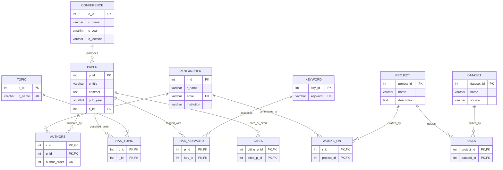

# Database Schema and Entity-Relationship Architecture

## 1. Overview
The **Research Collaboration Network** database (`research_collaboration_db`) is designed to capture complex academic relationships, collaborative research dynamics, multi-author publication hierarchies, and recursive citation graphs.

---

## 2. Entity-Relationship (ER) Diagram

---

## 3. Structural Breakdown

### Core Entity Tables
1. **`RESEARCHER`**: Academic personnel with unique verified emails and institutional affiliations.
2. **`CONFERENCE`**: Academic venues characterized by name, positive publication year (`CHECK (c_year > 0)`), and geographical location.
3. **`PAPER`**: Scholarly works with titles, abstracts, publication years, and nullable foreign keys to `CONFERENCE`.
   - Referenced conference deletion cascades via `ON DELETE SET NULL`, preserving publication records if a venue is discontinued.
4. **`TOPIC`**: High-level academic disciplines and domains (e.g., Computer Vision, Machine Learning).
5. **`KEYWORD`**: Granular technical tags and methodologies (e.g., CNN, Transformers, Neural Networks).
6. **`PROJECT`**: Sponsored research initiatives and institutional projects.
7. **`DATASET`**: Data repositories and benchmarks referenced with source URLs.

---

## 4. Many-to-Many Relationships & Junction Tables
Complex academic networks cannot be modeled via simple foreign keys; five junction tables decouple entities:

1. **`AUTHORS` (`RESEARCHER` ↔ `PAPER`)**:
   - Composite primary key: `(r_id, p_id)`.
   - Order preservation: `UNIQUE (p_id, author_order)` ensures valid 1..n author ranking without duplicate positions or gaps.
   - Referential integrity: `ON DELETE CASCADE` ensures researcher or paper removals cleanly eliminate authorship records.
2. **`HAS_TOPIC` (`PAPER` ↔ `TOPIC`)**:
   - Composite primary key: `(p_id, t_id)`. Supports multi-disciplinary papers.
3. **`HAS_KEYWORD` (`PAPER` ↔ `KEYWORD`)**:
   - Composite primary key: `(p_id, key_id)`. Granular indexing for similarity computations.
4. **`WORKS_ON` (`RESEARCHER` ↔ `PROJECT`)**:
   - Composite primary key: `(r_id, project_id)`. Tracks investigator allocations.
5. **`USES` (`PROJECT` ↔ `DATASET`)**:
   - Composite primary key: `(project_id, dataset_id)`. Maps data resource utilization across funded labs.

---

## 5. Recursive Graph Relationship: `CITES`
- Models directed citation links between papers (`citing_p_id` → `cited_p_id`).
- Self-referencing many-to-many relationship where both foreign keys target `PAPER(p_id)`.
- Foreign key deletion cascades (`ON DELETE CASCADE`) to prevent dangling citation links.
- Cycle safety and self-citation guard enforced via database triggers.

